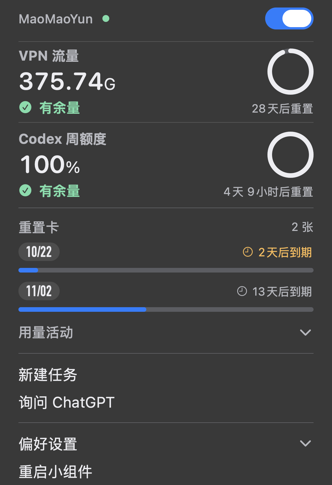
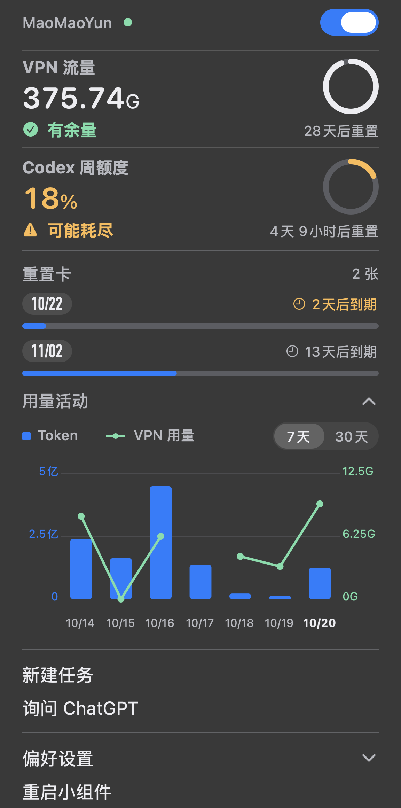

# Codex Usage Meter

把 Codex 剩余额度放进 macOS 菜单栏。

A lightweight, native macOS menu bar app for Codex usage limits and VPN traffic.

点击菜单栏圆环，查看 Codex 额度、VPN 流量、重置卡及用量活动。界面使用原生 NSMenu / AppKit，不需要一直打开用量页面，也不调用模型来维持监控。

> 非官方个人项目，与 OpenAI 无隶属关系。当前适合本机使用，采用 ad-hoc 签名，尚未完成 Developer ID 签名、公证或广泛的跨设备验证。

## 面板预览

<p align="center">
  
  
</p>

左侧为默认折叠状态，右侧为用量活动展开状态。图片由当前生产代码的原生 AppKit 视图渲染，使用演示数据，不包含个人账号或桌面内容；系统菜单外框与阴影未包含在图中。

## 主要功能

| 功能 | 说明 |
| --- | --- |
| 菜单栏额度圆环 | 优先显示 Session，未返回时显示 Weekly；剩余 ≤20% 为橙色、≤5% 为红色。中心可切换剩余额度数字或 Codex 图标。 |
| Codex 额度 | 按接口实际返回的窗口显示 Session / Weekly，查看余量、重置倒计时及进度提醒，不根据套餐名称猜测窗口。 |
| VPN 流量 | 显示 MaoMaoYun 官网报告的套餐余额、重置倒计时及条件预测；点击顶部名称打开客户端。 |
| 重置卡 | 按到期时间排列，显示日期胶囊、到期倒计时及剩余寿命进度；仅展示，不兑换或消耗重置卡。 |
| 用量活动 | 默认折叠，展开后切换最近 7 天 / 30 天。Token 为蓝色柱状，VPN 为绿色折线；悬停日期列可同时查看两项用量。 |
| 原生交互 | 淡灰色悬停、行内偏好设置和简体中文 / English 切换；动画遵循系统“减少动态效果”。 |
| 快捷操作 | 新建任务、询问 ChatGPT、重启小组件；不退出 Codex 主应用，不停止或续跑任务。 |
| 独立 App | 不占 Dock，支持单实例、登录启动、子进程恢复及安装失败回滚。 |
| 缓存与容错 | 后台读取，账号隔离；暂时失败保留已验证旧值并标记过期，缺失数据不伪装成真实零值。 |

**VPN 开关当前仅为动画预览。** 点击只移动滑块，不连接或断开 VPN，也不保存预览选择；状态点始终表示真实连接状态。已有的启动自动连接、睡眠唤醒后重新连接逻辑仍然有效，可能改变系统中名为 `MaoMaoYun` 的 VPN 服务状态。

### 界面与操作

- VPN 和 Codex 共用紧凑圆环布局：左侧余额、右侧容量圆环，底行左侧为提醒、右侧为重置倒计时。主面板不重复显示今日消耗或预计剩余。
- 绿色表示“有余量 / 进度正常”，橙色表示预警，红色表示真实耗尽或严重低余量；旧读数变灰，未知值只显示空轨道。
- 用量图的 Token 蓝色复用重置卡进度条和顶部开关，VPN 绿色复用正常预测状态。两项共用日期轴，但使用各自独立的纵轴与单位。
- 图表每次展开或切换日期范围，柱形与折线均在 0.5 秒内按日期从左到右同步重播。范围胶囊使用滑动切换，偏好设置使用 180ms 淡入下移动画。
- 图内悬停胶囊原位覆盖图例和范围按钮，移开恢复；其余区域没有额外悬浮说明窗口。
- 在“偏好设置”中修改菜单栏中心显示或语言，选择立即生效并保存；设置在当前菜单内向下展开，不弹侧边子菜单。
- 菜单栏数字或图标变绿表示检测到近期本机任务执行记录。这是本地记录推断，不是官方实时心跳。

## 使用前了解

- 需要 macOS，以及已安装、已登录的 Codex。额度读取优先使用桌面应用内置 CLI，也支持代码中列出的独立 CLI 安装位置。
- 任务运行提示依赖本机 Codex 数据库；仅安装 CLI 不等于具备桌面端的全部数据。
- MaoMaoYun 是可选集成，针对同名系统 VPN 服务实现，不是通用 VPN 插件。官网流量需要单独登录，与客户端账号相互独立。
- 运行 App 不需要 Node.js；源码验证、构建及安装需要 Node.js 和 Xcode Command Line Tools。
- 读取脚本还使用 `/usr/bin/jq`、`/usr/bin/sqlite3` 等系统工具。原生二进制包含 arm64 / x86_64，但不代表全部 macOS 版本或 Intel 设备均已验证。
- Codex 额度使用本机已有登录，不要求填写 API Key。

## 从源码安装

```sh
git clone https://github.com/WENTAO2297/CodexUsageMeter.git
cd CodexUsageMeter
zsh verify.sh
zsh install-autostart.command
```

安装器会先验证并构建，再切换运行版本：

| 内容 | 位置 |
| --- | --- |
| App | `~/Applications/Codex Usage Meter.app` |
| 缓存、日志、回滚 | `~/Library/Application Support/CodexUsageMeter` |
| 登录启动配置 | `~/Library/LaunchAgents/com.wentao.codex-usage-meter-watch.plist` |

上一版保存在数据目录的 `Rollback` 中，安装失败会尝试恢复。安装会重启小组件，不停止 Codex 任务。

只构建、不安装：

```sh
zsh build.sh
# 或指定一个尚不存在的目标路径
zsh build.sh "/path/to/Codex Usage Meter.app"
```

命令会打印生成的 App 路径，双击即可启动，不需要额外运行外部看守脚本。

### 登录 VPN 流量

首次没有流量数据时，点击 VPN 数据区域，在小组件自己的官网窗口登录，再点击“验证并连接”。验证成功后窗口关闭；密码只提交给官网，会话凭据仅保存在本 App 的 macOS 钥匙串条目 `Codex Usage Meter · MaoMaoYun` 中。

这里查询的是在小组件官网窗口登录的账号。客户端切换账号不会自动切换小组件会话；后台查询也不会自动弹出登录窗口。

### 卸载

```sh
zsh uninstall-autostart.command
```

这会停止小组件并删除 App、自启动配置、本地缓存、日志及回滚副本，不删除源码、Codex 聊天或工作文件。VPN 登录条目保留在系统钥匙串；如不再使用，可在“钥匙串访问”中删除 `Codex Usage Meter · MaoMaoYun`，不影响客户端自己的登录。

## 数据口径与刷新

### Codex 额度与提醒

额度来自本机 Codex CLI 的 `account/rateLimits/read`，只显示真实返回的窗口和重置期限。余量比周期剩余进度落后超过 5 个百分点时提示“消耗偏快”，余量不高于 5% 时提示“余量偏低”；进度提醒不等同于已经预测出准确的耗尽时间。

预测使用官方额度观察记录，历史不足时才采用经过账号、套餐及模型构成校验的本地数字摘要作为后备，不使用固定 Token 换算公式。Session 为短期条件情景，Weekly 按实际重置期限估计。模型不会调用大模型、兑换重置卡或自动续跑任务。

### Token 活动

Token 图直接读取与个人资料页相同的官方 `/wham/profiles/me` 日级统计，不从本机日志重算图表，也不展示输入、缓存、输出分类。

缓存覆盖包含今天的 30 个日历日期，图表按选择显示最近 7 天或 30 天。官方页面的“累计 Token 数”是累计总量，不等于当前日期范围的合计；今日为部分累计量，官方统计延迟或刷新时间不同也会造成短暂差异。Token 不折算为费用或额度。

### VPN 余额与用量

余额来自 MaoMaoYun 官网的 `/api/v1/user/getSubscribe`，日级计费用量来自 `/api/v1/user/stat/getTrafficLog`，不重复乘节点倍率。重置倒计时使用官网 `reset_day`，不把套餐到期日当成重置时间。

图表按本机日历日期配对 Token 与 VPN 记录，不按数组位置拼接。VPN 缺报不补零、折线不跨缺口；官网明确返回零才显示零。查询结果可能迟报或修订，不等同于实时网络速率。

条件预测基于已验证的历史日级用量。只有典型路径预计在重置前用尽时，才显示“预计提前 N 天用尽”；不足一天显示“预计提前 <1 天用尽”。预测不是够用保证，未知重置期限或数据过期时不编造结论。算法与验证边界见[预测设计](docs/FORECAST_DESIGN.md)。

### 后台刷新与睡眠恢复

Token 和 VPN 余额通常每 5 分钟更新，打开菜单时距上次查询至少 1 分钟；HTTP 429 至少退避 15 分钟，不因打开菜单或唤醒而绕过。图表切换范围只读取缓存，不额外请求。

系统唤醒后先完成既有 VPN 重连并等待连接稳定，再优先同步流量；短暂网络或钥匙串锁定失败后有限重试，最多 3 次查询、3 分钟，然后恢复普通刷新频率。临时失败保留已验证旧值并变灰；登录失效、账号或会话变化时停止复用，缺失数据不当成零流量。

## 数据与隐私

- Codex 额度查询可能需要联网获取账号额度，但不发送模型提示进行轮询。
- 本地任务状态通过只读 SQLite 查询获取；不读取置顶列表，不修改 Codex 数据库，不控制任务停止或续跑。
- 缓存为账号或匿名会话隔离。目录权限为 `0700`，文件权限为 `0600`，采用原子写入；只保存相应的额度、日期、Token、计费字节及预测数字摘要，不保存聊天内容。
- Token 读取器在进程内使用本机已有 Codex 登录，只向固定官网地址发送只读 GET。凭据不传入命令行、环境变量、缓存或日志，不读取浏览器登录。
- VPN 凭据只存本 App 自己的钥匙串条目，不读取客户端或其他浏览器的认证缓存。登录窗口使用临时 WebKit 会话，验证后不持久化浏览器 cookies / localStorage。
- 官网读取启用正常 TLS 校验、拒绝重定向并限制响应大小；不向日志输出凭据、账号邮箱、订阅链接或原始响应正文。
- 提交 issue 前请检查截图和日志；不要上传认证文件、完整数据库、个人缓存或未经检查的桌面截图。

## 开发与验证

主界面与业务使用 JXA / AppKit，外层 Cocoa 启动器负责单实例、子进程管理和恢复，不依赖外部看守脚本。源码按数据读取、纯模型、绘制、菜单交互、偏好设置及 VPN 顶部控件拆分，由 `Sources/modules.list` 确定装配顺序；架构检查防止模块漏载、重复声明和纯模型混入原生调用。

```sh
# 完整离线回归：模型、读取器替身、原生 AppKit 布局与交互
zsh verify.sh

# 额外读取当前账号的实际额度和本地数据库（只读）
zsh verify.sh --live

# 使用演示数据渲染当前原生面板，不读取真实账号或切换 VPN
node Tests/meter-panels-ui.cjs --preview

# 校验已构建 App 的结构、签名和资源
node Tests/app-bundle.cjs "/path/to/Codex Usage Meter.app"
```

进一步说明：

- [开发架构、刷新机制与诊断](docs/DEVELOPMENT.md)
- [预测算法与验证边界](docs/FORECAST_DESIGN.md)
- [历史 Token 后备预测](docs/TOKEN_FORECAST.md)
- [面板布局与交互验收](docs/METER_PANELS_DESIGN.md)

## 已知限制

- Codex 数据库结构、CLI 协议、深链接和官网内部接口可能随版本变化，没有公开兼容承诺。
- 今日统计可能延迟；长时间不写本地执行记录的任务也可能被显示为空闲。
- 离线回归和合成历史回放不能证明真实长期预测准确率，也不代表所有系统事件排列或其他 Mac 均已验证。
- 当前 App 为本地 ad-hoc 签名，尚未公证，不是已完成跨设备分发验证的正式发行包。
- 仓库仅发布检查后的源码、测试和说明，不包含私人开发历史、账号缓存、备份或旧版二进制。
- 当前仓库尚未指定开源许可证。
